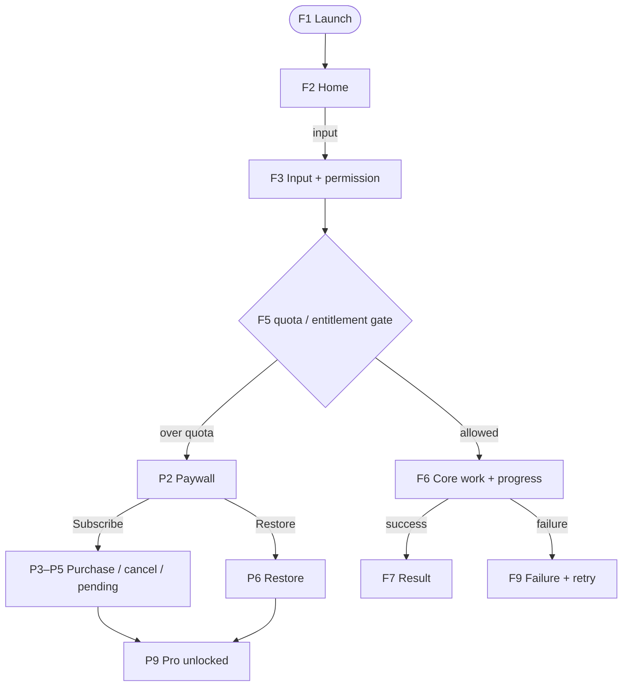

# <App name> — user-flow audit

- Repo: `<owner/repo>` @ `<sha>` · bundle `<id>` · min iOS `<n>` · audit date `<YYYY-MM-DD>` (PT)
- Auditor mode: static code read | ran on simulator | ran on device  (say which; tag the rest `(inferred)` / `[RUNTIME]`)
- Not found in repo (so not audited): <onboarding? login? sync? widgets? push? server APIs?>
- Evidence read: README, TODO, docs/*, Sources/**, Info.plist/pbxproj settings, scheme, .storekit, Tests/**, .github/workflows/*, live privacy page

## ID scheme (stable — never renumber)

- `F<n>` core app flows · `P<n>` purchase / IAP / Pro flows · steps `F3.4`, `P7.4`
- Bug titles are `[F3.4] symptom`. PRs, issues, verdicts and traceability all key on these IDs.
- Risk in the index: **H** likely user-visible bug / revenue / compliance · **M** fragile / unverified · **L** low

## Navigation model, persisted state, permissions

| Key / store | Meaning | Written at (`file:line`) |
|---|---|---|

Permissions: <usage strings, background modes, tracking, privacy manifest summary>

## Index

| Flow ID | Name | Entry point | # steps | Risk |
|---|---|---|---|---|
| F1 | First launch & bootstrap | App icon | | |
| F2 | Library / home | | | |
| F3 | Capture / input + permission | | | |
| F… | Core action → result → play/share | | | |
| F… | Settings, errors/offline/interruptions, hidden dev menu | | | |
| P1 | Free-tier limits & paywall triggers | | | |
| P2 | Paywall presentation & product load | | | |
| P3 | Purchase success | | | |
| P4 | Purchase cancel & failure | | | |
| P5 | Pending / Ask to Buy / SCA | | | |
| P6 | Restore purchases | | | |
| P7 | Entitlement checks: renewal, expiry, refund, offline | | | |
| P8 | Reinstall / new device / backup | | | |
| P9 | How paid features unlock and lock | | | |
| P10 | Telemetry, privacy & compliance of the funnel | | | |
| P11 | App Review & ops reachability (review notes, StoreKit config, CI) | | | |

## Overview (mermaid; also render to `overview.png`)

## Flow section (repeat per flow)

### F<n> — <name>
Entry: <how the user gets here>. Optional per-flow mermaid with step IDs as node labels.

| Step | Expected | Acceptance (testable) | Risk / evidence |
|---|---|---|---|
| F<n>.1 | <behavior> | <exact check + observable result> | R: <suspicion> `path:line` |

## Part C — StoreKit test plan
See `storekit-test-matrix.md` (copy cases that apply; each case lists the step IDs it validates).

## Product gaps and UX observations
<facts from code, ordered by impact — product opinions go in the product review, not here>

## Riskiest spots (top 5–10, with step IDs)
## What could not be verified (and what is needed: device, sandbox, App Review)
